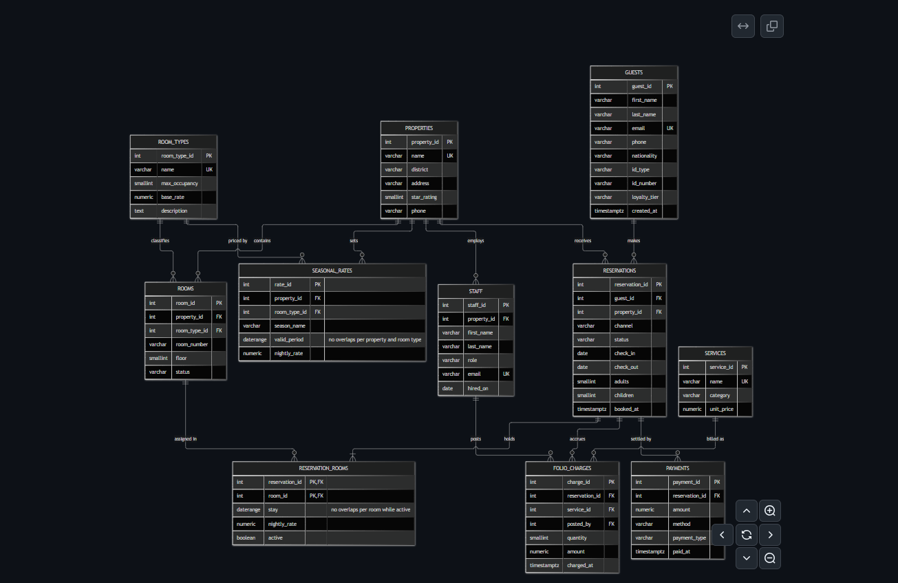
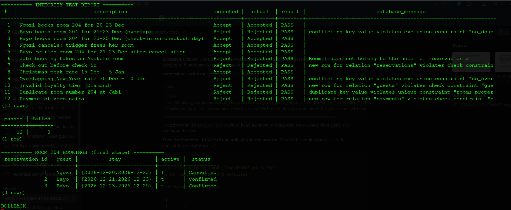

# 01: Database Design and Modelling

## Organisation profile

| | |
|---|---|
| **Organisation** | Savannah Crest Hotels (simulated) |
| **Location** | Abuja, Nigeria |
| **Properties** | Savannah Crest Asokoro (40 rooms), Savannah Crest Jabi (60 rooms), Savannah Crest Gwarinpa (50 rooms) |
| **Business** | Hotel accommodation with on-site services: restaurant, laundry, spa and airport pickup |
| **Booking channels** | Website, phone, walk-in and online travel agents (OTAs) |

## Who uses the database

- **Reservations agents and the website:** search availability, create, change and cancel bookings.
- **Front desk officers:** check guests in and out, assign rooms.
- **Service staff (restaurant, laundry, spa, drivers):** post charges to a guest's bill (folio).
- **Accounts:** take deposits, settle bills, issue refunds.
- **Property managers:** set seasonal prices, monitor occupancy and revenue.

## What the database stores

Properties, room types, individual rooms, seasonal prices, guests, staff, reservations, the rooms and nights each reservation holds, services, charges posted to guest bills, and payments.

## What the database must support

1. Search which rooms are free for a given date range at a property.
2. Create, modify and cancel reservations, across one or more rooms.
3. **Guarantee that a room is never booked for overlapping nights.**
4. Apply the correct nightly price for the season.
5. Check guests in and out.
6. Post service charges to a guest's bill and record payments.
7. Report occupancy and revenue per property.

## Contents

| File | What it is |
|---|---|
| [`erd.md`](erd.md) | ER diagram written in Mermaid (GitHub draws it automatically) |
| [`schema.sql`](schema.sql) | 11 tables, constraints, 2 triggers |
| [`normalisation.md`](normalisation.md) | Functional dependencies and normalisation from a booking spreadsheet to BCNF |
| [`integrity_tests.sql`](integrity_tests.sql) | Automated PASS/FAIL test harness |
| `evidence/` | Rendered diagram, schema structure, test report and screenshot |

## ER diagram

The diagram source is [`erd.md`](erd.md). Eleven entities are linked by one-to-many relationships; `reservation_rooms` resolves the many-to-many link between reservations and rooms.

## Design highlights

**1. Date ranges instead of separate dates.** A stay is stored as one `daterange` value, e.g. `[2026-12-20,2026-12-23)`. The square bracket includes the 20th; the round bracket excludes the 23rd (checkout day). This matches how hotels count nights, and lets one guest check out on the same day another checks in.

**2. Exclusion constraints.** A normal UNIQUE constraint can only stop *identical* values. Hotels need to stop *overlapping* ones:

| Constraint | Rule |
|---|---|
| `no_double_booking` | Same room, overlapping stays, both active: rejected. Uses `EXCLUDE USING gist (room_id WITH =, stay WITH &&) WHERE (active)` |
| `no_overlapping_rates` | Same hotel and room type, overlapping price periods: rejected |

`&&` is PostgreSQL's "overlaps" operator. The `btree_gist` extension allows a GiST index to combine `=` on a number with `&&` on a range.

**3. Triggers for rules that span tables.**

| Trigger | When | What it does |
|---|---|---|
| `trg_check_room_property` | Before a room is added to a booking | Rejects a room from a different hotel than the booking |
| `trg_release_rooms` | After a booking becomes Cancelled or No-show | Sets its rooms to `active = false`, freeing the nights automatically |

**4. Other constraints.** CHECK rules on star rating, occupancy, statuses, booking channels, loyalty tiers, payment methods, positive prices, and `check_out > check_in`; UNIQUE room numbers per hotel; foreign keys on every relationship.

**5. Identity keys.** Primary keys use `GENERATED ALWAYS AS IDENTITY`, so the database always assigns IDs and an application cannot insert its own by mistake.

## Testing

`integrity_tests.sql` runs each case inside its own sub-transaction (a PL/pgSQL `BEGIN ... EXCEPTION` block), records whether it was accepted or rejected, and compares that with the expected outcome. The whole run is rolled back, so no test data remains.

| # | Scenario | Expected | Result |
|---|---|---|---|
| 1 | Book room 204 for 20-23 Dec | Accept | PASS |
| 2 | Book room 204 for 21-23 Dec (overlap) | Reject | PASS (`no_double_booking`) |
| 3 | Book room 204 from 23 Dec (checkout day) | Accept | PASS |
| 4 | Cancel the first booking | Accept | PASS (trigger frees room) |
| 5 | Retry the overlapping booking | Accept | PASS |
| 6 | Jabi booking takes an Asokoro room | Reject | PASS (trigger) |
| 7 | Check-out before check-in | Reject | PASS (`valid_stay_dates`) |
| 8 | Christmas peak rate | Accept | PASS |
| 9 | Overlapping New Year rate | Reject | PASS (`no_overlapping_rates`) |
| 10 | Loyalty tier "Diamond" | Reject | PASS |
| 11 | Duplicate room number at Jabi | Reject | PASS |
| 12 | Payment of NGN 0 | Reject | PASS |

**Result: 12 of 12 passed.** Full output: `evidence/integrity_test_report.txt`.

## How to run

    sudo -u postgres createdb savannah_crest
    psql -U postgres -h localhost -d savannah_crest -f schema.sql
    psql -U postgres -h localhost -d savannah_crest -f integrity_tests.sql
