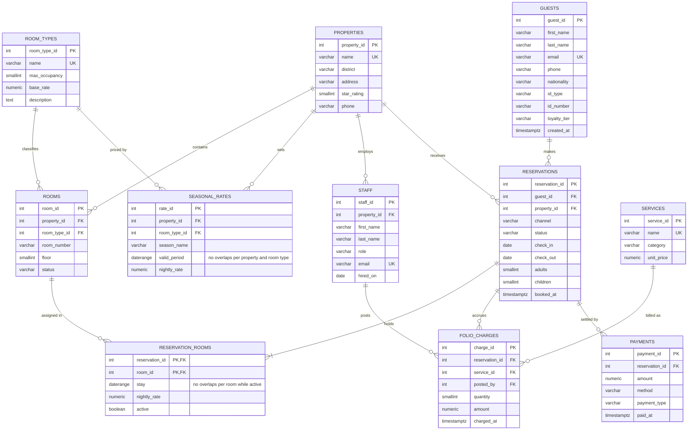

# Savannah Crest Hotels: Entity-Relationship Diagram

## Reading the diagram

- `||--o{` means **one to many**: one property contains many rooms.
- `||--|{` means **one to one-or-more**: every reservation holds at least one room.
- `RESERVATION_ROOMS` resolves the **many-to-many** link between reservations and rooms (one booking can hold several rooms; one room is booked many times over its life).
- `daterange` columns store a whole period (e.g. 20 to 23 December) as **one value**, which lets PostgreSQL check for overlapping stays directly.
