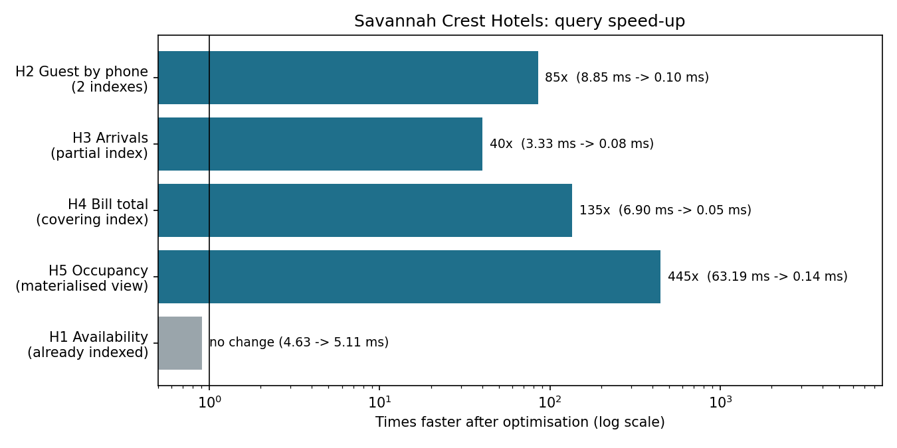
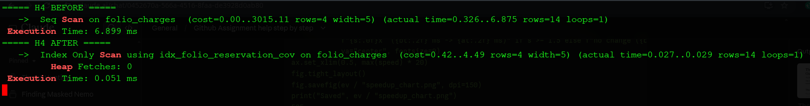

# 02: Query Performance

We loaded 5 years of hotel data, ran 10 business queries, found the slow ones, and fixed them.

## The data

A Python script ([`generate_data.py`](generate_data.py)) creates 2022 to 2026 history; [`load_data.sql`](load_data.sql) bulk-loads it.

| Rooms | Guests | Reservations | Charges | Payments |
|---|---|---|---|---|
| 150 | 15,000 | 55,386 | 149,049 | 86,527 |

## The queries

[`queries.sql`](queries.sql): availability search, guest history, arrivals list, guest bill, **occupancy %**, **ADR** (average price per night sold), **RevPAR** (revenue per available room), extras revenue, top guests, year-on-year growth, booking lead time.

## What was slow, and the fix

| Query | Problem | Fix | Before | After |
|---|---|---|---|---|
| H2 Guest by phone | Read every guest and every reservation | Indexes on `phone` and `guest_id` | 8.85 ms | 0.10 ms |
| H3 Tomorrow's arrivals | Read all 55,386 reservations to find 16 | **Partial index**: only confirmed bookings (40 kB) | 3.33 ms | 0.08 ms |
| H4 Guest bill total | Read 149,049 charges to find 14 | **Covering index**: the amount is stored in the index, so the table is never read | 6.90 ms | 0.05 ms |
| H5 Monthly occupancy | Recalculated every time | **Materialised view**: results saved in advance | 62.96 ms | 0.14 ms |

## Lessons

- **The exclusion constraint is also an index.** The availability search (H1) was already fast because the "no double booking" rule from Part 01 built a GiST index.
- **A partial index can be tiny.** It only covers the rows a query needs.
- **A materialised view is fast but can go stale.** It must be refreshed (319 ms here) when bookings change, so it suits reports, not live screens.
- **Whole-table reports don't improve.** Queries that add up everything (top guests, yearly growth) read all rows anyway.

## Files

`evidence/` holds row counts, query results, execution plans before and after, and the optimisation output.

## How to run

    python3 generate_data.py
    psql -U postgres -h localhost -d savannah_crest -f load_data.sql
    psql -U postgres -h localhost -d savannah_crest -f explain_plans.sql > evidence/explain_before.txt
    psql -U postgres -h localhost -d savannah_crest -f optimise.sql
    psql -U postgres -h localhost -d savannah_crest -f explain_plans.sql > evidence/explain_after.txt
    python3 plot_speedup.py
