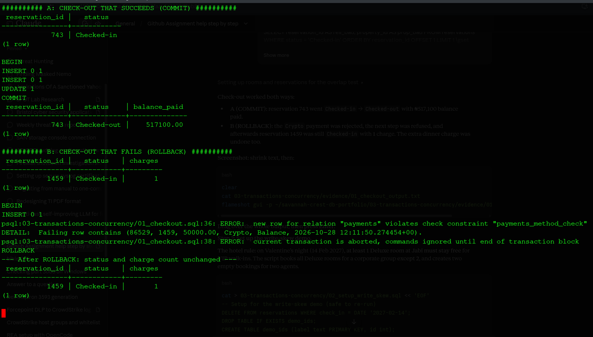
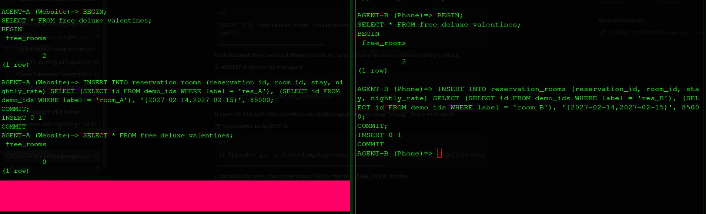
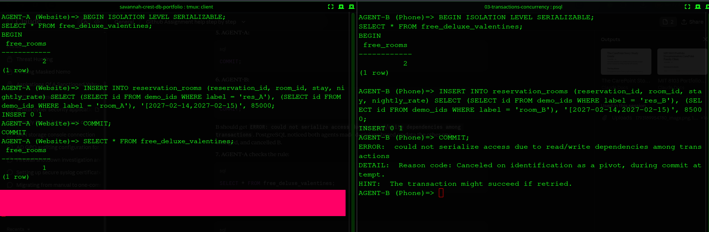
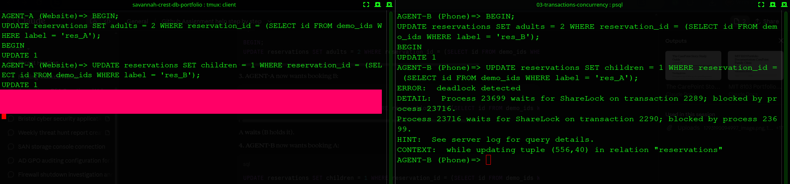

# 03: Transactions and Concurrency

Three demos: a check-out that must succeed or fail as one unit, and two problems that only appear when two staff work at the same time.

## Demo 1: Check-out (COMMIT and ROLLBACK)

Check-out has 3 steps: post the last charge, take the balance, mark the guest checked out. [`01_checkout.sql`](01_checkout.sql)

| Case | What happened | Result |
|---|---|---|
| Succeeds | All 3 steps ran, then `COMMIT` | Guest checked out, NGN 517,100 paid |
| Fails | Payment method "Crypto" rejected; PostgreSQL refused the next step | `ROLLBACK`: guest still checked in, the extra charge was undone too |

## Demo 2: Write skew (two agents break a hotel rule)

**Rule:** on Valentine's night, keep at least 1 Deluxe room free at Jabi. Two rooms are free. [`02_setup_write_skew.sql`](02_setup_write_skew.sql)

| Step | Agent A | Agent B |
|---|---|---|
| 1 | Checks: 2 free, OK to book | Checks: 2 free, OK to book |
| 2 | Books room A | Books room B |
| 3 | Commits | Commits |

| Isolation level | Outcome |
|---|---|
| `READ COMMITTED` (default) | Both bookings saved, **0 rooms free: rule broken**, no error |
| `SERIALIZABLE` | Agent B's commit **rejected** ("could not serialize access"); 1 room stays free |

The bookings were for **different rooms**, so no constraint could catch this. Only `SERIALIZABLE` notices that each agent's decision depended on data the other changed.

## Demo 3: Deadlock

Two agents update the same two bookings in **opposite order**:

| Step | Agent A | Agent B |
|---|---|---|
| 1 | Locks booking A | Locks booking B |
| 2 | Wants booking B: waits | Wants booking A: waits |
| 3 | Continues | **Cancelled: "deadlock detected"** |

PostgreSQL checks for circles of waiting after 1 second and cancels one transaction so the other can finish.
**Prevention:** always lock rows in the same order (e.g. lowest reservation ID first).

## Lessons

- A transaction keeps multi-step work all-or-nothing.
- Some rules span several rows; constraints can't see them, but `SERIALIZABLE` can. The cost: the app must retry rejected transactions.
- Deadlocks can't be fully avoided, but a consistent locking order makes them rare.

Session logs: `evidence/session_A.log`, `evidence/session_B.log`.
