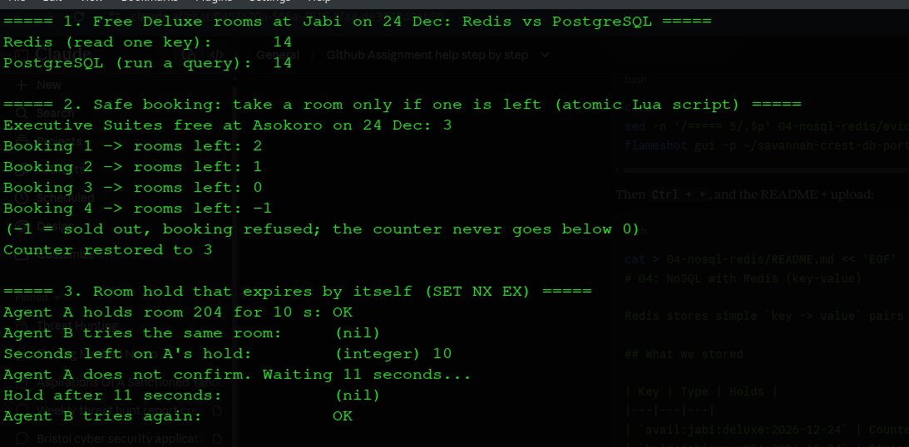
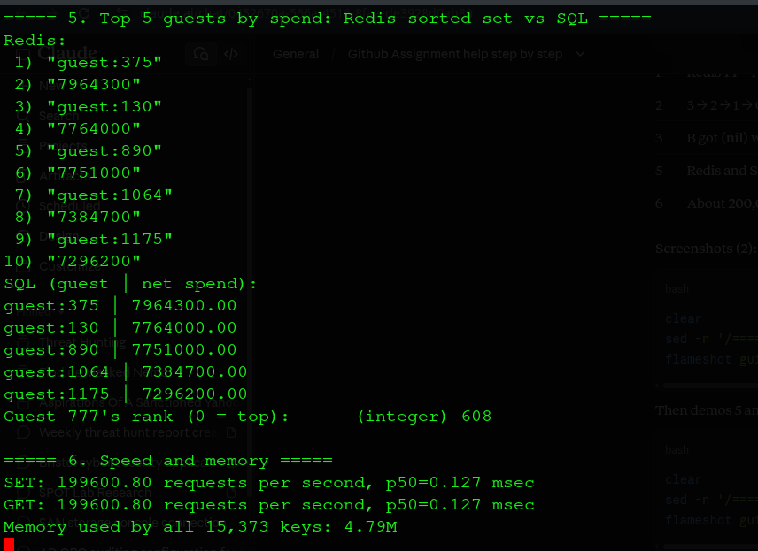

# 04: NoSQL with Redis (key-value)

Redis stores simple `key -> value` pairs **in memory**, so it is extremely fast. We used it beside PostgreSQL for data that changes every second. PostgreSQL stays the official record.

## What we stored

| Key | Type | Holds |
|---|---|---|
| `avail:jabi:deluxe:2026-12-24` | Counter | Free rooms per hotel, room type and night (Dec 2026) |
| `hold:jabi:room204:2026-12-24` | String with expiry | A temporary hold while a guest pays |
| `guest:777` | Hash | Guest profile |
| `guests:net_spend` | Sorted set | All guests ranked by spend |

Data was copied from PostgreSQL ([`01_export_to_redis.sql`](01_export_to_redis.sql)): 29,214 commands, 15,373 keys.

## Demos ([`02_redis_demo.sh`](02_redis_demo.sh))

| Demo | Result |
|---|---|
| Rooms free on 24 Dec | Redis 14, PostgreSQL 14: same answer, Redis just reads a number |
| **Safe booking** (small Lua script, runs without interruption) | 3, 2, 1, 0, then **-1: refused**. The count never goes negative |
| **Room hold** (`SET ... NX EX 10`) | Second agent blocked; hold **deleted itself** after 10 s, then the second agent got it |
| Top 5 guests | Redis ranking matches SQL exactly |
| Speed | About **200,000** operations per second; all keys use **4.8 MB** |

## When to use Redis (and when not)

| Good fit | Poor fit |
|---|---|
| Live counters (rooms left tonight) | The official booking record |
| Short-lived data that should expire (holds, login sessions) | Rules across many records (e.g. no overlapping stays) |
| Rankings and leaderboards | Reports joining several kinds of data |

**Why not use Redis for everything?** Data lives in memory, so it is limited by RAM and can be lost in a crash unless saved to disk. It has no joins and no constraints like PostgreSQL's exclusion constraint. So the hotel keeps bookings in PostgreSQL and uses Redis as a fast helper beside it.

## Other NoSQL types (brief)

| Type | Example | Hotel use |
|---|---|---|
| Document | MongoDB | Guest profiles with varying preferences |
| Column-family | Cassandra | Huge streams such as door-lock or Wi-Fi logs |
| Graph | Neo4j | Recommending hotels from guests' travel patterns |

## How to run

    sudo docker run -d --name savannah-redis -p 6380:6379 redis:7
    psql -U postgres -h localhost -d savannah_crest -At -f 01_export_to_redis.sql > /tmp/redis_load.txt
    sudo docker exec -i savannah-redis redis-cli < /tmp/redis_load.txt
    ./02_redis_demo.sh
