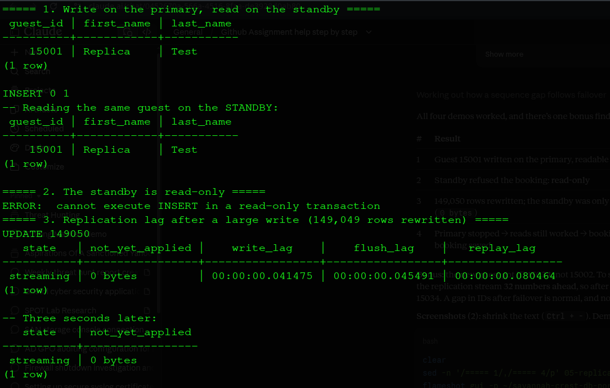
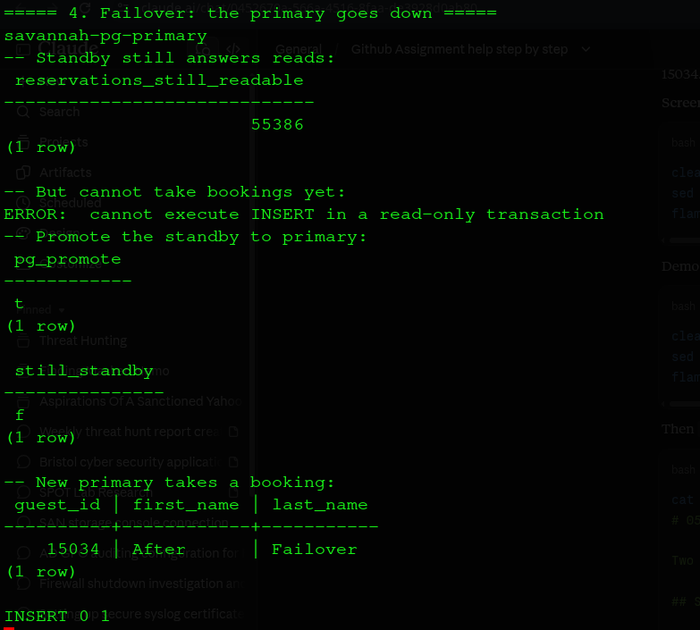

# 05: Replication and Cloud

Two PostgreSQL servers in Docker: a **primary** that takes all bookings, and a **standby** that receives every change as a live stream and keeps an exact copy. If the primary fails, the standby is **promoted** and takes over.

## Setup ([`01_setup_replication.sh`](01_setup_replication.sh))

1. Start the primary and create a `replicator` user allowed to stream changes.
2. Copy the `savannah_crest` database in (`pg_dump`).
3. Clone the primary into the standby (`pg_basebackup -R`), which then keeps following it.

Check: `state = streaming`, `sync_state = async`, and 55,386 reservations on both servers.

## Demos ([`02_replication_demos.sh`](02_replication_demos.sh))

| Demo | Result |
|---|---|
| Book on the primary, read on the standby | New guest visible on the standby within 1 second |
| Book on the standby | Refused: the standby is **read-only** |
| Rewrite 149,050 rows on the primary | Standby only **0.08 s** behind, then fully caught up |
| Stop the primary, promote the standby | Reads kept working; after `pg_promote()` the standby accepted bookings |

**Observation:** after failover the next guest ID was 15034, not 15002. PostgreSQL logs ID counters 32 values ahead, so a gap after failover is normal. No data was lost.

## Key ideas in plain words

| Term | Meaning |
|---|---|
| **Asynchronous** (used here) | The primary confirms a booking before the standby has it. Fastest, but a crash at exactly the wrong moment can lose the last fraction of a second |
| **Synchronous** | The primary waits for the standby before confirming. No loss, but every booking is slower, and it stalls if the standby is down |
| **Read scaling** | Reports can run on the standby so they don't slow down bookings |
| **Failover** | Promoting the standby. Here done by hand; tools such as Patroni do it automatically |

**Consistency vs availability (CAP):** async replication favours availability and speed; a read on the standby might be a fraction of a second out of date. Bookings should read from the primary; reports can use the standby.

## Sharding (design only)

Replication copies **everything**. Sharding splits data so each server holds a **part**. For Savannah Crest, splitting by hotel (one server per property) would be natural, because almost every booking query concerns one hotel. At 150 rooms this is unnecessary; it would matter for a chain with hundreds of hotels.

## Cloud option

Managed services (e.g. AWS RDS, Azure Database for PostgreSQL) run the same primary + standby setup across data centres, with automatic failover and backups. Trade-offs: monthly cost, internet dependence, and guest data held by a third party, which must comply with Nigeria's data protection law (NDPA).

## Lesson

Replication protects against a **server** failing, not against **mistakes**: an accidental delete is copied to the standby too. Backups are still needed.
