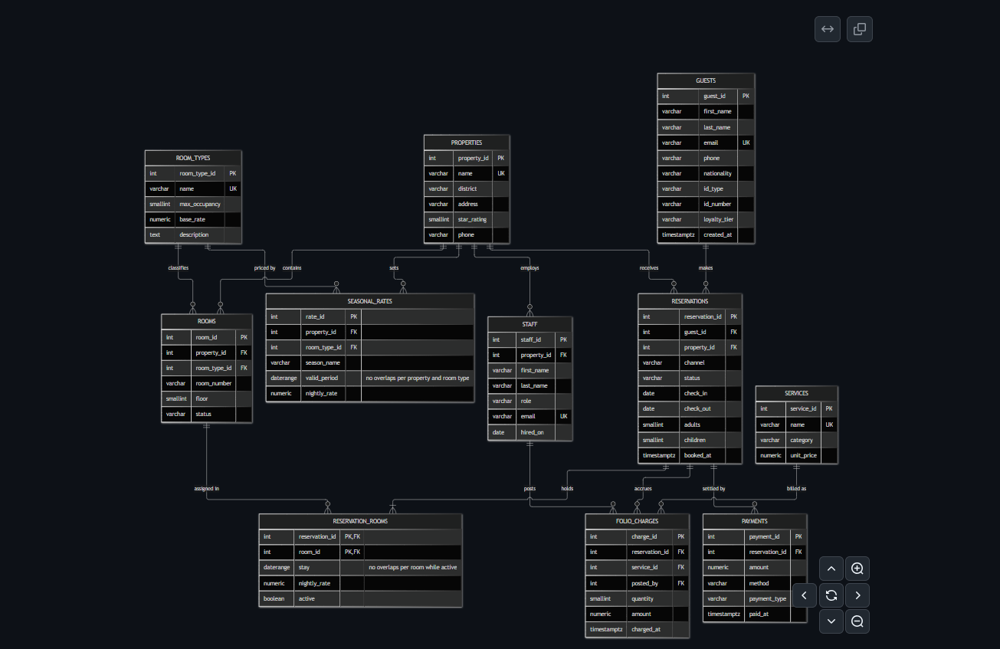

# Savannah Crest Hotels: Advanced Database Systems Portfolio

**MIT 8103 - Advanced Database Systems (CA)** 

**Student: Aniekwe Chioma Rita**

**Student ID: 301908570**

**Case study:** Savannah Crest Hotels, a hotel group in Abuja with three properties (Asokoro, Jabi, Gwarinpa) and 150 rooms. Guests book online, by phone or at the desk; staff check them in and out, charge extras to the room and take payments.

## Results at a glance

| Part | Topic | Headline result |
|---|---|---|
| [01](01-design-and-modelling/) | Design and modelling | 11 tables in BCNF; **exclusion constraint** makes overlapping room bookings impossible; 12/12 tests passed |
| [02](02-query-performance/) | Query performance | 362,000 rows; queries up to **440x faster** with partial and covering indexes and a materialised view |
| [03](03-transactions-concurrency/) | Transactions and concurrency | Check-out all-or-nothing; **write skew** caught only by `SERIALIZABLE`; a **deadlock** detected and resolved |
| [04](04-nosql-redis/) | NoSQL (Redis) | Live room counters, holds that expire by themselves, guest rankings: ~200,000 operations per second |
| [05](05-replication-cloud/) | Replication and cloud | Primary + standby; standby 0.08 s behind; **promoted** after the primary was stopped, with no data lost |

## Tools

PostgreSQL 17, Redis 7, Docker, Python 3, Git. Each folder has a short README, the scripts, and an `evidence/` folder with outputs and screenshots.
